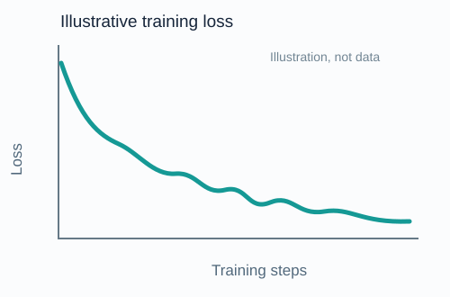

::: notes
About 10 minutes. The supervisor spelling and affiliation come from the local project brief; confirm against the names to be supplied. Design will be revised once the example is available.
:::

## The problem: how should we update the weights?

::: {.columns}
::: {.column width="53%"}
```python
for x, y in train_loader:
    optimizer.zero_grad()
    loss = criterion(model(x), y)
    loss.backward()
    optimizer.step()  # how should we update?
```

The optimizer turns gradients into parameter updates.
:::
::: {.column width="47%"}
{width="100%"}
:::
:::

::: {.takeaway}
**Question:** Can an update use the structure of the model to reach a good solution faster?
:::

::: notes
The curve is an illustration, not a measured training run. Loss may fluctuate in practice.
:::

## Gradient descent and SGD

$$\theta_{t+1} = \theta_t - \eta\, g_t$$

::: {.columns}
::: {.column width="50%"}
### Gradient descent
Uses the full dataset to compute the gradient. Simple, but expensive for large datasets.
:::
::: {.column width="50%"}
### Stochastic gradient descent
Uses a mini-batch estimate. Cheaper updates, with noise that changes from step to step.
:::
:::

::: {.takeaway}
The usual update uses **Euclidean geometry**: it treats the gradient as the update direction.
:::

## Adam and AdamW

::: {.columns}
::: {.column width="50%"}
### Adam
Combines momentum with coordinate-wise scaling based on past squared gradients.

$$\theta_{t+1}\approx\theta_t-\eta\frac{m_t}{\sqrt{v_t}+\epsilon}$$
:::
::: {.column width="50%"}
### AdamW
Uses the Adam update with **decoupled weight decay**.

A common baseline for training modern neural networks.
:::
:::

::: {.takeaway}
Adaptive scaling helps, but it does not automatically capture the role of each layer.
:::

## Changing the geometry

::: {.columns}
::: {.column width="33%"}
### Linear oracle
A **linear minimization oracle** (LMO) finds the best direction for a linear objective over a chosen feasible set.
:::
::: {.column width="33%"}
### Frank–Wolfe
Uses an LMO to optimize over a constrained set, avoiding an explicit projection step.
:::
::: {.column width="33%"}
### Mirror descent
Uses a geometry defined by a potential and its Bregman divergence to form updates.
:::
:::

::: {.takeaway}
**Modular duality:** choose layer-aware norms and combine them into an architecture-aware update.
:::

::: notes
These are related geometry-aware tools, not interchangeable algorithms. Frank–Wolfe is a constrained method; modular duality uses duality maps. See Bernstein & Newhouse, Modular Duality in Deep Learning, 2024; Jaggi, 2013.
:::

## Muon: a matrix-aware example

::: {.columns}
::: {.column width="55%"}
1. Accumulate a momentum matrix from the gradient.
2. Approximately orthogonalize that matrix.
3. Apply a scaled update to matrix weights.

Other parameters can use a different optimizer, such as AdamW.
:::
::: {.column width="45%"}
### Why it matters

The update acts on a **matrix as a whole**, reflecting its geometry rather than independently scaling every coordinate.
:::
:::

::: {.takeaway}
Muon motivates the question: **what geometry fits each architectural component?**
:::

::: notes
Muon implementations vary in scaling and which parameters they apply to. The polar-factor interpretation motivates a connection to spectral geometry; it is not a claim that every Muon variant is an exact optimizer for every architecture.
:::

## Research question

### Can we design efficient updates from norms adapted to a model's components?

::: {.columns}
::: {.column width="50%"}
**Start from existing results**

- Linear layers and embeddings have distinct roles.
- Existing work derives candidate layerwise norms and duality maps.
:::
::: {.column width="50%"}
**Investigate new settings**

- Attention: heads, variants, and residual connections.
- State-space architectures such as Mamba.
- Other widely used modules and compositions.
:::
:::

::: {.takeaway}
The appropriate norm is a **hypothesis to derive and test**, not a universal choice.
:::

## Goals and evaluation

1. **Theory** — derive candidate norms and practical updates; study convergence under explicit assumptions.
2. **Experiments** — compare against SGD, AdamW, and Muon on controlled training tasks.
3. **Speed** — aim for a competitive optimizer on the modded NanoGPT speedrun, under its applicable rules.
4. **Usability** — explore PyTorch-compatible modules and optimizer tooling that select appropriate geometry.

::: notes
Compare training quality, time to target, memory, compute and sensitivity to tuning. A usable library and speedrun competitiveness are ambitions, not established results. Benchmark rules must be checked when the experiment is run.
:::

## A three-year plan

::: {.columns}
::: {.column width="33%"}
### Year 1
**Build foundations**

- Master geometry and optimizer literature.
- Reproduce baselines and set up benchmarks.
- Identify promising layer-level questions.
:::
::: {.column width="33%"}
### Year 2
**Develop and test**

- Derive candidate norms and updates.
- Analyze assumptions and convergence.
- Run controlled architecture comparisons.
:::
::: {.column width="33%"}
### Year 3
**Scale and share**

- Test promising methods at larger scale.
- Pursue the NanoGPT speedrun goal.
- Package reusable PyTorch tooling and publish results.
:::
:::

::: notes
This is a proposed plan, subject to the project's scope, resources, and research findings. The three-year duration is the user's stated ambition.
:::

## Why this topic? Where next?

::: {.columns}
::: {.column width="50%"}
### Motivation

- Connect mathematics with real deep learning systems.
- Understand how architecture changes optimization.
- Build methods that others can use.
:::
::: {.column width="50%"}
### Professional ambitions

- Join an AI research lab or startup—or build a startup.
- Explore AI and LLMs as research tools to work faster and investigate deeper questions.
:::
:::

::: {.takeaway}
My goal: combine **theory, experiments, and useful tools**.
:::

## References {.smaller}

- Bernstein & Newhouse, *Modular Duality in Deep Learning*, 2024. [arXiv:2410.21265](https://arxiv.org/abs/2410.21265)
- Bernstein & Newhouse, *Old Optimizer, New Norm: An Anthology*, 2024. [arXiv:2409.20325](https://arxiv.org/abs/2409.20325)
- Kingma & Ba, *Adam: A Method for Stochastic Optimization*, 2015. [arXiv:1412.6980](https://arxiv.org/abs/1412.6980)
- Loshchilov & Hutter, *Decoupled Weight Decay Regularization*, 2019. [arXiv:1711.05101](https://arxiv.org/abs/1711.05101)
- Jaggi, *Revisiting Frank-Wolfe: Projection-Free Sparse Convex Optimization*, 2013. [PMLR](https://proceedings.mlr.press/v28/jaggi13.html)
- Keller Jordan et al., *Muon: An optimizer for hidden layers in neural networks*, 2024. [Project](https://kellerjordan.github.io/posts/muon/)

## Thank you

### Questions and discussion

Matteo Ledevehat · CVN

