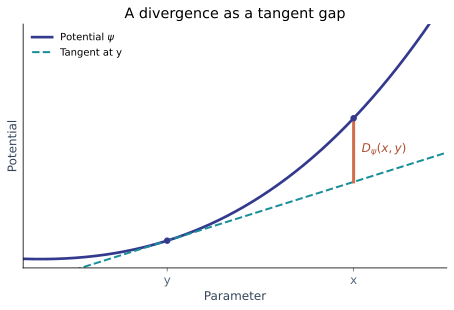

---
format:
  revealjs:
    theme: [default, custom.scss]
    slide-number: true
    progress: true
    transition: fade
    width: 1280
    height: 720
    margin: 0.07
    code-overflow: wrap
    highlight-style: github
---

## Non-Euclidean Optimization Methods for Machine Learning {.opening}

### Mathéo Le Dévéhat

Antonio-José Silveti-Falls · CVN

## The problem: how should we update the weights?

For data $(x_i,y_i)_{i=1}^n$, a model $f_\theta$ and a per-example loss $\ell$:

$$\min_{\theta}\; L(\theta)=\frac1n\sum_{i=1}^{n}\ell(f_\theta(x_i),y_i) \qquad \text{(empirical risk)}$$

::: {.columns .loop}
::: {.column width="52%"}
```{.python}
for x, y in train_loader:
    optimizer.zero_grad()
    loss = criterion(model(x), y)
    loss.backward()
    optimizer.step()
```
:::
::: {.column width="48%"}
{width="100%"}
:::
:::

::: notes
The curve is synthetic, not an experimental measurement. A batch loss estimates empirical risk; full-dataset loss is an average over all examples.
:::

## Gradient descent and stochastic gradient descent

The first-order local approximation of a differentiable objective is

$$L(\theta+\Delta)\approx L(\theta)+\langle\nabla L(\theta),\Delta\rangle.$$

For convex $L$, the linearization is also a global lower bound.

::: {.columns}
::: {.column width="50%"}
### Gradient descent
$$\theta_{t+1}=\theta_t-\eta\nabla L(\theta_t)$$
Gradient of the full empirical risk.
:::
::: {.column width="50%"}
### SGD
$$\theta_{t+1}=\theta_t-\eta g_t$$
$g_t$ is a mini-batch gradient estimate.
:::
:::

## Adam and AdamW: full update

Initialize $m_0=v_0=0$. For $t=1,2,\ldots$, compute batch gradient $g_t$:

$$\begin{aligned}
m_t&=\beta_1m_{t-1}+(1-\beta_1)g_t,\\
v_t&=\beta_2v_{t-1}+(1-\beta_2)g_t^{\odot 2},\\
\hat m_t&=m_t/(1-\beta_1^t),\qquad \hat v_t=v_t/(1-\beta_2^t).
\end{aligned}$$

$$\begin{aligned}
\text{Adam:}\quad \theta_{t+1}&=\theta_t-\eta_t\frac{\hat m_t}{\sqrt{\hat v_t}+\epsilon},\\
\text{AdamW:}\quad \theta_{t+1}&=(1-\eta_t\lambda)\theta_t-\eta_t\frac{\hat m_t}{\sqrt{\hat v_t}+\epsilon}.
\end{aligned}$$

$m_t$: momentum; $v_t$: squared-gradient average; $\epsilon$: numerical stabilizer. Operations are coordinate-wise.

::: {.source}
Sources: [Kingma & Ba, Adam](https://arxiv.org/abs/1412.6980); [Loshchilov & Hutter, AdamW](https://arxiv.org/abs/1711.05101). Adam shown without L2 regularization; AdamW uses decoupled decay.
:::

## Mirror descent: a different geometry

The potential $\psi$ determines how movement away from the current point is measured:

$$D_\psi(x,y)=\psi(x)-\psi(y)-\langle\nabla\psi(y),x-y\rangle.$$

::: {.columns}
::: {.column width="53%"}
### Primal update
$$x_{t+1}=\arg\min_{x\in C}\left\{\eta\langle g_t,x\rangle+D_\psi(x,x_t)\right\}.$$

For $\psi(x)=\frac12\|x\|_2^2$, this becomes projected gradient descent.
:::
::: {.column width="47%"}
{width="100%"}
:::
:::

::: {.source}
Sources: [Bubeck, Convex Optimization, §§4.1–4.3](https://arxiv.org/abs/1405.4980); [Reid, Bregman divergences](https://mark.reid.name/blog/meet-the-bregman-divergences.html).
:::

## Dual coordinates and norm dualization

### Mirror descent in dual coordinates

$$z_t=\nabla\psi(x_t),\qquad z_{t+1}=z_t-\eta g_t,\qquad x_{t+1}=\nabla\psi^*(z_{t+1}).$$

This unconstrained form requires the mirror-map assumptions and valid dual-domain iterates.

### Norm-based dualizer (modular duality)

$$\operatorname{dualize}_{\|\cdot\|}(g)\in\arg\max_{\|u\|=1}\langle g,u\rangle,\qquad g\ne0.$$

This is the paper's **unit-direction** convention; it is not the same map as $\nabla\psi^*$ above.

::: {.source}
Sources: [Bubeck, §4.2](https://arxiv.org/abs/1405.4980); [Bernstein & Newhouse, Definitions 1–2](https://arxiv.org/abs/2410.21265).
:::

## Frank–Wolfe and the linear minimization oracle

Given a compact convex feasible set $C$, define

$$s_t\in\operatorname{LMO}_C(g_t)=\arg\min_{s\in C}\langle g_t,s\rangle.$$

The Frank–Wolfe update is

$$x_{t+1}=(1-\gamma_t)x_t+\gamma_t s_t,\qquad 0\leq\gamma_t\leq1.$$

The LMO selects a point minimizing the linearized objective over $C$; the update remains feasible without a projection.

::: {.source}
Source: [Jaggi, Revisiting Frank–Wolfe, Algorithm 1](https://proceedings.mlr.press/v28/jaggi13.html).
:::

## Modular norms: geometry by layer

### Definition · induced operator norm

Given input norm $\|\cdot\|_\alpha$ and output norm $\|\cdot\|_\beta$,

$$\|W\|_{\alpha\to\beta}=\sup_{\|x\|_\alpha\leq1}\|Wx\|_\beta.$$

It measures the largest output magnitude produced by an input in the unit ball.

### Design idea

Choose layer norms from their input and output roles, then derive a dualizer for each module.

::: {.source}
Source: [Bernstein & Newhouse, Definition 3](https://arxiv.org/abs/2410.21265).
:::

## Modular norms: the paper's layer table

{width="100%"}

$G=U\Sigma V^\top$ denotes a reduced SVD; the paper specifies the exact scaling and conventions.

::: {.source}
Source: [Bernstein & Newhouse, Modular Duality in Deep Learning, Table 1, p. 7](https://arxiv.org/abs/2410.21265).
:::

## Muon

{width="74%"}

Other parameters can use a different optimizer such as AdamW.

::: {.source}
Source: [Keller Jordan, Muon](https://kellerjordan.github.io/posts/muon/). The algorithm image requires an internet connection.
:::

## Newton–Schulz in Muon

Starting from a normalized matrix $X_0$, the practical iteration in Jordan's implementation is

$$A_k=X_kX_k^\top,\qquad X_{k+1}=aX_k+(bA_k+cA_k^2)X_k.$$

- Five iterations; $a=3.4445$, $b=-4.7750$, $c=2.0315$.
- Transpose tall matrices before the iteration, then transpose back.
- It produces a fast **approximate** orthogonalization; finite iterates need not equal the exact polar factor.

::: {.source}
Source: [Keller Jordan, Muon: NewtonSchulz5](https://kellerjordan.github.io/posts/muon/).
:::

## Does Muon scale?

### Large-model evidence

- **Kimi K2** · pre-trained with MuonClip; **Kimi K3** · per-head Muon.
- **DeepSeek-V4.1-Flash** · Muon for backbone matrices and head-wise Muon for Q/K.
- **GLM-5** · head-wise Muon reported in the DeepSeek technical report.

**Other frontier models:** Mistral Large 4 “Le Chonk” and Muse Spark Open have public model information; their Muon usage was not verified from primary training reports.

::: {.source}
Sources: [Kimi K2](https://github.com/MoonshotAI/Kimi-K2), [Kimi K3 report](https://github.com/MoonshotAI/Kimi-K3/blob/main/k3_tech_report.pdf), [DeepSeek-V4.1 report, §3](https://arxiv.org/html/2609.19969), [Mistral Large 4](https://huggingface.co/blog/mistral-large4), [Muse Spark Open](https://huggingface.co/docs/transformers/en/model_doc/muse_spark).
:::

## What optimizers do JEPA world models use?

### Training recipes vary by model

- **V-JEPA 2-AC:** AdamW for action-conditioned model training.
- **UniJEPA:** Adam for the models reported in its training setup.
- **Temporal Discriminative World Models:** the authors report a fused Muon–AdamW training optimizer in their experiments.

The training optimizer updates model weights. Planning can use a separate optimizer, such as the cross-entropy method over action sequences.

::: {.source}
Sources: [V-JEPA 2, §D](https://arxiv.org/html/2506.09985), [UniJEPA, implementation details](https://arxiv.org/html/2608.07409), [Temporal Discriminative World Models](https://td-worldmodel.github.io/TD-WorldModel/). These are specific reported recipes, not a claim about every JEPA model.
:::

## Research question

### What norms and updates fit modern architectures?

- **DeepSeek-V4.1-Flash:** compressed sparse attention 2 (CSA2), cross-layer KV/index reuse and sliding windows.
- **Kimi K3:** Kimi Delta Attention (KDA), gated MLA and attention residuals.
- **Mistral Large 4:** MLA with a sparse attention indexer and cross-layer KV sharing.
- **State-space models:** architectures such as Mamba.

::: {.source}
Sources: [DeepSeek-V4.1, §2.3](https://arxiv.org/html/2609.19969), [Kimi K3](https://github.com/MoonshotAI/Kimi-K3), [Mistral Large 4](https://huggingface.co/blog/mistral-large4), [Mamba](https://arxiv.org/abs/2312.00752). Examples are as documented in November 2026.
:::

## Goals and evaluation

1. **Theory** — derive candidate layer norms, duality maps and efficient updates; study convergence under explicit assumptions.
2. **Experiments** — compare against SGD, AdamW and Muon with controlled tuning and compute budgets.
3. **Speed** — aim for a competitive optimizer on the modded NanoGPT speedrun, under the applicable rules.
4. **Usability** — develop PyTorch-compatible modules and optimizer tooling: users build models with familiar layers, while the optimizer associates supported parameters with the appropriate candidate geometry.

::: notes
The API, norm selection and speedrun performance are proposed goals, not established results. Compare loss, time to target, memory and sensitivity to tuning.
:::

## A three-year plan

## Motivation and professional ambitions

::: {.columns}
::: {.column width="50%"}
### Motivation

- Understand the geometry behind deep learning, instead of treating optimizers as black boxes.
- Connect mathematics with deep learning systems.
- Develop state-of-the-art optimizers.
:::
::: {.column width="50%"}
### Professional ambitions

- Join an AI research lab or startup—or create a startup.
- Explore AI and LLMs as research tools to work faster and investigate deeper questions.
:::
:::

## Thank you {.closing}
