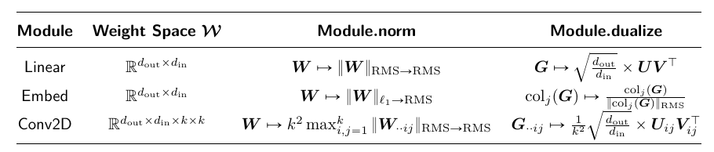

---
format:
  revealjs:
    theme: [white, custom.scss]
    center: false
    slide-number: true
    progress: true
    transition: fade
    width: 1280
    height: 720
    margin: 0.07
    code-overflow: wrap
    highlight-style: github
---

## Non-Euclidean Optimization Methods for Machine Learning {.opening}

### Mathéo Le Dévéhat

Antonio-José Silveti-Falls · CVN

## The problem: how should we update the weights?

For data $(x_i,y_i)_{i=1}^n$, a model $f_\theta$ and a per-example loss $\ell$:

$$\min_{\theta}\; L(\theta)=\frac1n\sum_{i=1}^{n}\ell(f_\theta(x_i),y_i) \qquad \text{(empirical risk)}$$

::: {.columns .loop}
::: {.column width="52%"}
```{.python}
for x, y in train_loader:
    optimizer.zero_grad()
    loss = criterion(model(x), y)
    loss.backward()
    optimizer.step()
```
:::
::: {.column width="48%"}
{width="100%"}
:::
:::

::: notes
The curve is synthetic, not an experimental measurement. A batch loss estimates empirical risk; full-dataset loss is an average over all examples.
:::

## Gradient descent and stochastic gradient descent

The first-order local approximation of a differentiable objective is

$$L(\theta+\Delta)\approx L(\theta)+\langle\nabla L(\theta),\Delta\rangle.$$

For convex $L$, the linearization is also a global lower bound.

::: {.columns}
::: {.column width="50%"}
### Gradient descent
$$\theta_{t+1}=\theta_t-\eta\nabla L(\theta_t)$$
Gradient of the full empirical risk.
:::
::: {.column width="50%"}
### SGD
$$\theta_{t+1}=\theta_t-\eta g_t$$
$g_t$ is a mini-batch gradient estimate.
:::
:::

## Adam and AdamW: full update

Initialize $m_0=v_0=0$. For $t=1,2,\ldots$, compute batch gradient $g_t$:

$$\begin{aligned}
m_t&=\beta_1m_{t-1}+(1-\beta_1)g_t,\\
v_t&=\beta_2v_{t-1}+(1-\beta_2)g_t^{\odot 2},\\
\hat m_t&=m_t/(1-\beta_1^t),\qquad \hat v_t=v_t/(1-\beta_2^t).
\end{aligned}$$

$$\begin{aligned}
\text{Adam:}\quad \theta_{t+1}&=\theta_t-\eta_t\frac{\hat m_t}{\sqrt{\hat v_t}+\epsilon},\\
\text{AdamW:}\quad \theta_{t+1}&=(1-\eta_t\lambda)\theta_t-\eta_t\frac{\hat m_t}{\sqrt{\hat v_t}+\epsilon}.
\end{aligned}$$

$m_t$: momentum; $v_t$: squared-gradient average; $\epsilon$: numerical stabilizer. Operations are coordinate-wise.

::: {.slide-source}
Sources: [Kingma & Ba, Adam](https://arxiv.org/abs/1412.6980); [Loshchilov & Hutter, AdamW](https://arxiv.org/abs/1711.05101). Adam shown without L2 regularization; AdamW uses decoupled decay.
:::

## Mirror descent

::: {.mirror-layout}
**Geometry.** The gradient $g_t\in V^*$ is a dual vector; a geometry maps it to the primal space $V$ before updating parameters.

**Dual coordinates.** Unconstrained mirror descent updates in dual space and maps back:

$$\begin{aligned}
z_t&=\nabla\psi(x_t),\\
z_{t+1}&=z_t-\eta g_t,\\
x_{t+1}&=\nabla\psi^*(z_{t+1}).
\end{aligned}$$

**Norm-based dualizer.** For $g\ne0$,

$$\operatorname{dualize}_{\|\cdot\|}(g)\in\arg\max_{\|u\|=1}\langle g,u\rangle.$$

This unit-direction map is distinct from $\nabla\psi^*$.
:::

::: {.slide-source}
Sources: [Bubeck, §§4.1–4.3](https://arxiv.org/abs/1405.4980); [Bernstein & Newhouse, Definitions 1–2](https://arxiv.org/abs/2410.21265).
:::

::: notes
The dual-coordinate expression assumes an invertible mirror map and iterates in its domain. The gradient is a covector; direct addition without a primal-dual identification is a type mismatch.
:::

## Frank–Wolfe and the linear minimization oracle

Given a compact convex feasible set $C$, define

$$s_t\in\operatorname{LMO}_C(g_t)=\arg\min_{s\in C}\langle g_t,s\rangle.$$

The Frank–Wolfe update is

$$x_{t+1}=(1-\gamma_t)x_t+\gamma_t s_t,\qquad 0\leq\gamma_t\leq1.$$

The LMO selects a point minimizing the linearized objective over $C$; the update remains feasible without a projection.

::: {.slide-source}
Source: [Jaggi, Revisiting Frank–Wolfe, Algorithm 1](https://proceedings.mlr.press/v28/jaggi13.html).
:::

## Modular norms: geometry by layer

### Definition · induced operator norm

Given input norm $\|\cdot\|_\alpha$ and output norm $\|\cdot\|_\beta$,

$$\|W\|_{\alpha\to\beta}=\sup_{\|x\|_\alpha\leq1}\|Wx\|_\beta.$$

It measures the largest output magnitude produced by an input in the unit ball.

### Design idea

Choose layer norms from their input and output roles, then derive a dualizer for each module.

::: {.slide-source}
Source: [Bernstein & Newhouse, Definition 3](https://arxiv.org/abs/2410.21265).
:::

## Modular norms: the paper's layer table

{width="100%"}

$G=U\Sigma V^\top$ denotes a reduced SVD; the paper specifies the exact scaling and conventions.

::: {.slide-source}
Source: [Bernstein & Newhouse, Modular Duality in Deep Learning, Table 1, p. 7](https://arxiv.org/abs/2410.21265).
:::

## Muon

{width="74%"}

Other parameters can use a different optimizer such as AdamW.

::: {.slide-source}
Source: [Keller Jordan, Muon](https://kellerjordan.github.io/posts/muon/). The algorithm image requires an internet connection.
:::

## Newton–Schulz in Muon

Starting from a normalized matrix $X_0$, the practical iteration in Jordan's implementation is

$$A_k=X_kX_k^\top,\qquad X_{k+1}=aX_k+(bA_k+cA_k^2)X_k.$$

- Five iterations; $a=3.4445$, $b=-4.7750$, $c=2.0315$.
- It produces a fast **approximate** orthogonalization; finite iterates need not equal the exact polar factor.

**At scale:** Kimi K3 and DeepSeek-V4.1-Flash use Muon variants. Mistral Large 4 used Muon in RL post-training and AdamW in pretraining.

::: {.slide-source}
Sources: [Jordan](https://kellerjordan.github.io/posts/muon/), [Kimi K3](https://github.com/MoonshotAI/Kimi-K3), [DeepSeek-V4.1](https://arxiv.org/html/2609.19969), [Mistral Large 4, §§2 and 4.4.1](https://www.alphaxiv.org/pdf/2611.mistral-large-4).
:::

## Research question

### What norms and updates fit modern architectures?

- New attention algorithms
- State-space models (SSMs)?
- H-Net
- JEPA
- Mixture-of-Experts (MoE)

## Goals and evaluation

1. **Theory** — derive candidate layer norms, duality maps and efficient updates; study convergence under explicit assumptions.
2. **Experiments** — compare against SGD, AdamW and Muon with controlled tuning and compute budgets.
3. **Speed** — aim for a competitive optimizer on the modded NanoGPT speedrun, under the applicable rules.
4. **Usability** — develop PyTorch-compatible modules and optimizer tooling: users build models with familiar layers, while the optimizer associates supported parameters with the appropriate candidate geometry.

::: notes
The API, norm selection and speedrun performance are proposed goals, not established results. Compare loss, time to target, memory and sensitivity to tuning.
:::

## A three-year plan

::: {.columns}
::: {.column width="33%"}
### Year 1
- Explore the literature: SOAP, Shampoo and others.
- Run small-scale experiments on already covered architectures.
:::
::: {.column width="33%"}
### Year 2
- Explore new norms for specific modules.
- Make a competitive modded NanoGPT speedrun attempt.
:::
::: {.column width="33%"}
### Year 3
- Create a PyTorch/JAX library that makes modular norms the default.
:::
:::

## Motivation and professional ambitions

::: {.columns}
::: {.column width="50%"}
### Motivation

- Understand the geometry behind deep learning, instead of treating optimizers as black boxes.
- Connect mathematics with deep learning systems.
- Develop state-of-the-art optimizers.
:::
::: {.column width="50%"}
### Professional ambitions

- Join an AI research lab or startup—or create a startup.
- Explore AI and LLMs as research tools to work faster and investigate deeper questions.
:::
:::

## <span style="display:block;text-align:center">Thank you</span> {.closing}
